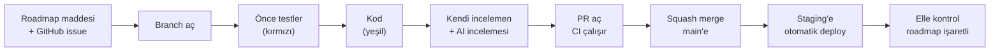

# Katkı ve Çalışma Kuralları

> Durum: Onaylandı v1.0 · Repodaki yeri: `CONTRIBUTING.md` (repo kökü) · Roadmap maddesi: P0-18

Bu doküman, projede bir değişikliğin fikirden production'a nasıl ilerlediğini tanımlar. Kurallar hem geliştirici hem yapay zeka agent'ı için geçerlidir; agent'a özel ek kurallar `CLAUDE.md`'dedir.

## 1. Bir değişikliğin yolculuğu



1. **İş bir roadmap maddesiyle başlar.** Roadmap'te olmayan iş yapılmaz (`docs/roadmap.md` §1). Her madde için bir GitHub issue vardır.
2. **Branch açılır** (§2).
3. **Testler önce yazılır** ve kırmızı oldukları görülür (ADR-0008).
4. **Kod yazılır**, testler yeşile döner.
5. **Kendi kendine inceleme ve AI incelemesi** yapılır (§6).
6. **PR açılır**; CI otomatik çalışır.
7. **Squash merge** ile `main`'e alınır (§4).
8. **Staging'e otomatik deploy** edilir ve elle kontrol edilir.
9. Definition of Done'ın (`docs/roadmap.md` §1.4) tüm maddeleri karşılanmışsa iş biter.

## 2. Branch'ler

- **Trunk-based development:** tek uzun ömürlü branch `main`'dir. `develop` veya `release` branch'i yoktur.
- `main` korumalıdır: doğrudan push yasak; merge için PR ve yeşil CI zorunlu.
- Çalışma branch'leri **kısa ömürlüdür**: en fazla 2–3 gün. Daha uzun sürecek bir iş, daha küçük parçalara bölünür.
- İsimlendirme: `<tür>/<issue-no>-<kısa-açıklama>`, İngilizce ve küçük harf.
  - `feat/42-enroll-student`
  - `fix/57-attendance-timezone`
  - `docs/12-adr-0005`

Neden trunk-based: kısa ömürlü branch'ler birbirinden uzaklaşmaz, merge çakışmaları küçük kalır ve `main` her zaman deploy edilebilir durumdadır. CI/CD'nin anlamlı olması için de bu gereklidir.

## 3. Commit mesajları

[Conventional Commits](https://www.conventionalcommits.org/) biçimi kullanılır. Commit mesajları **İngilizce**dir (DEC-030).

```
<tür>(<kapsam>): <kısa açıklama>

<isteğe bağlı gövde: neden yapıldı>

Refs: P1-26, US-17
```

- **Tür:** `feat` (yeni özellik), `fix` (hata düzeltme), `refactor` (davranışı değiştirmeyen yeniden düzenleme), `test`, `docs`, `chore` (bakım), `ci`, `build`, `perf`.
- **Kapsam:** modül adı veya alan: `enrollments`, `identity`, `admin-web`, `ci`, `adr`.
- **Kısa açıklama:** emir kipinde, küçük harfle başlar, nokta ile bitmez, en fazla 72 karakter: `feat(enrollments): enforce group capacity with row locks`.
- **Gövde:** *ne* yapıldığını değil, *neden* yapıldığını anlatır.
- **Altbilgi:** ilgili roadmap maddesi ve hikaye.
- Geriye dönük uyumsuz bir API değişikliği `BREAKING CHANGE:` altbilgisiyle belirtilir.
- Commit mesajlarında AI attribution satırı bulunmaz (DEC-035); `commit-msg` hook'u bunu garanti eder.

## 4. Pull request'ler

- **Merge yöntemi: squash merge.** Bir PR, `main`'de tek bir commit olur. Bu yüzden **PR başlığı Conventional Commits biçiminde** yazılır; squash commit'inin mesajı olur.
- **Boyut:** en fazla yaklaşık 400 değişen satır, üretilmiş kod hariç (NFR-MNT-05). Bir hikaye büyükse birkaç PR'a bölünür (ör. önce domain ve testleri, sonra API, sonra arayüz). Her PR tek başına `main`'i bozmamalıdır.
- **Tek konu:** bir PR tek bir roadmap maddesine aittir. "Bu arada şunu da düzelttim" değişiklikleri ayrı PR olur.
- **PR açıklaması** şablonu izler (`.github/pull_request_template.md`):

```markdown
## Ne
<!-- Bu PR ne yapıyor? -->

## Neden
<!-- Hangi problemi çözüyor? -->

## İlgili
Roadmap: P1-xx · Hikaye: US-xx · Issue: #xx

## Nasıl test edildi
<!-- Hangi testler eklendi, elle ne kontrol edildi? -->

## Ekran görüntüsü
<!-- Arayüz değişikliği varsa -->

## Kontrol listesi
- [ ] Kabul kriterlerinin hepsi testlerle karşılanıyor
- [ ] Kod doğru katmanda ve modülde
- [ ] Tenant'a bağlı yeni entity'ler `ITenantScoped`
- [ ] Loglarda kişisel veri yok
- [ ] Yeni hata kodları `docs/api/error-codes.md`'de ve Angular dil dosyasında
- [ ] Migration varsa üretilen SQL incelendi
- [ ] Mevcut testler zayıflatılmadı veya silinmedi
- [ ] Gerekli dokümanlar güncellendi
- [ ] Roadmap maddesi işaretlendi
```

## 5. Kod stili

- **C#:** `.editorconfig` kuralları; `dotnet format` CI'da kontrol edilir. Uyarılar hata sayılır (NFR-MNT-01).
  - Sınıflar varsayılan olarak `sealed`; handler'lar `internal sealed` (ADR-0004).
  - `async` metotlar `CancellationToken` alır ve iletir.
  - Nullable reference types açık.
  - Sabit zaman yerine `TimeProvider` kullanılır; `DateTime.Now` yasak.
- **TypeScript / Angular:** ESLint ve Prettier; CI'da kontrol edilir. `any` kullanılmaz.
- **İsimlendirme:** domain modelindeki ortak dile uyulur (`docs/domain/domain-model.md` §1). Aynı kavram için farklı kelime kullanılmaz.

## 6. Kod incelemesi

Her PR iki incelemeden geçer:

1. **Kendi incelemen:** PR'ın tüm diff'i, GitHub arayüzünde satır satır okunur. Yazdığın veya agent'ın yazdığı her satırı açıklayabilmelisin; açıklayamadığın kod merge edilmez.
2. **AI incelemesi:** yeni bir agent oturumunda, kodu yazmamış bir agent'a PR incelettirilir. İnceleme şu soruları cevaplar:
   - Kabul kriterlerinin hepsi karşılanıyor mu? Eksik bir senaryo var mı?
   - Mimari kurallara (katmanlar, modüller, `Contracts`) uyuluyor mu?
   - Tenant izolasyonu, yetkilendirme ve kişisel veri kuralları ihlal ediliyor mu?
   - Hatalar `Result` ile mi dönüyor; hata kodları katalogda mı?
   - Testler davranışı mı test ediyor, yoksa iç yapıya mı bağlı?
   - İsimlendirme ortak dile uyuyor mu?

İnceleme yorumlarının her biri ya düzeltilir ya da neden düzeltilmediği PR'da yazılır.

## 7. Veritabanı migration'ları

- Migration'lar EF Core ile üretilir; adı ne yaptığını anlatır: `AddEnrollmentsPartialUniqueIndex`.
- Üretilen SQL her zaman incelenir (`dotnet ef migrations script`); PR'da dikkat çekici kısımlar not edilir.
- **Uygulanmış bir migration asla düzenlenmez veya silinmez.** Düzeltme, yeni bir migration ile yapılır.
- Veri kaybına yol açabilecek değişiklikler (sütun silme, yeniden adlandırma, tip değiştirme) PR'da açıkça belirtilir. Faz 4'teki kesintisiz deploy hedefi için, bu tür değişiklikler şimdiden iki adımda yapılmaya alışılır: önce yeni yapı eklenir, kod ona geçer, eski yapı sonraki bir sürümde kaldırılır (expand–contract).

## 8. Bağımlılıklar

- Yeni bir NuGet veya npm paketi eklemeden önce sahibin onayı alınır.
- Her yeni paket için PR'da şunlar yazılır: neden gerekli, lisansı, alternatifleri.
- Ticari lisans gerektiren paketler kullanılmaz. Yasaklı paketler (ör. `MediatR`, `AutoMapper`, `FluentAssertions`) CI'da kontrol edilir (DEC-048, DEC-061).
- NuGet paket sürümleri merkezi olarak `Directory.Packages.props`'ta yönetilir.

## 9. Dokümantasyon

- Davranışı veya bir kararı değiştiren her PR, ilgili dokümanı da aynı PR'da günceller.
- Yeni bir mimari karar gerekiyorsa önce ADR yazılır ve onaylanır, sonra kod yazılır.
- Kabul edilmiş bir ADR düzenlenmez; değişiklik yeni bir ADR ile yapılır.

## 10. Sürümler

- [Semantic Versioning](https://semver.org/): `MAJOR.MINOR.PATCH`. Her faz bir minor sürüm (`v0.1.0` = MVP); `v1.0.0` faz 5'in sonunda.
- `CHANGELOG.md`, [Keep a Changelog](https://keepachangelog.com/) biçiminde tutulur; her PR, değişikliğini "Unreleased" bölümüne ekler.
- Sürümler Git etiketiyle (`git tag v0.1.0`) işaretlenir.
