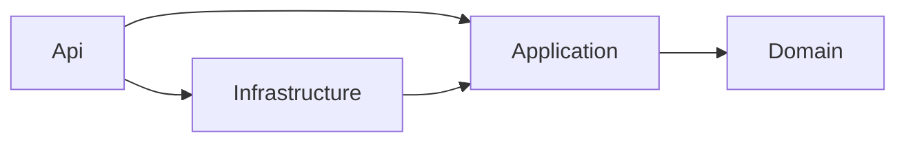

# ADR-0001: Clean Architecture katmanlarıyla modüler monolit kullan

> Repodaki yeri: `docs/adr/0001-modular-monolith-clean-architecture.md`

| Alan | Değer |
| --- | --- |
| Durum | `Accepted` |
| Tarih | 2026-10-27 |
| Karar veren | Batuhan Tümer |
| İlgili kararlar | DEC-023, DEC-025, DEC-034 |
| İlgili gereksinimler | NFR-MNT-02, NFR-SCL-01, NFR-CST-01 |

## Bağlam

Platformun genel mimari şeklini belirlememiz gerekiyor. Bu karar; projenin klasör yapısını, nasıl deploy edildiğini, nasıl test edildiğini ve ileride nasıl büyüyebileceğini belirler. Sonradan değiştirmesi en pahalı kararlardan biridir.

Kararı etkileyen gerçekler:

- Projeyi **tek bir geliştirici** geliştiriyor; yapay zeka agent'ları ile birlikte.
- MVP'de yaklaşık 10 alt alan (domain) var: kimlik, okullar, branş ve tesisler, gruplar, öğrenciler, kayıtlar, yoklama, aidatlar, duyurular.
- Alanlar birbirine sıkı bağlı: kayıt; öğrenciyi, grubu ve programı aynı anda bilmek zorunda.
- Bütçe aylık 20 USD ve tek sunucu (DEC-034, DEC-033).
- Faz 5'te bir modülün (bildirimler) ayrı bir servise çıkarılması planlanıyor; mimari buna izin vermeli.
- Projenin birincil amacı öğrenme: mimari, Türkiye'deki .NET mülakatlarında sıkça sorulan kalıpları (Clean Architecture, DDD) gerçekçi biçimde içermeli.

## Karar kriterleri

1. **Basitlik:** tek geliştirici için geliştirme, test ve deploy kolay olmalı.
2. **Sınırların netliği:** iş kuralları altyapıdan ve alanlar birbirinden ayrı olmalı; agent'ın yanlış yere kod yazması zorlaşmalı.
3. **Test edilebilirlik:** iş kuralları veritabanı ve framework olmadan test edilebilmeli.
4. **Gelişebilirlik:** ileride bir modül, büyük bir yeniden yazma olmadan servise çıkarılabilmeli.
5. **Maliyet:** tek sunucuda, düşük kaynakla çalışmalı.
6. **Öğrenme değeri:** sektörde yaygın ve anlatılabilir kalıplar.

## Değerlendirilen seçenekler

### Seçenek 1: Klasik katmanlı monolit (N-layer)

Tüm uygulama `Controllers`, `Services`, `Repositories` gibi teknik katmanlara bölünür. Alanlar arasında bir sınır yoktur; her servis her repository'yi kullanabilir.

- **Artıları:** En bilinen ve en hızlı başlanan yapı. Az proje, az soyutlama.
- **Eksileri:** İş kuralları servislere ve controller'lara dağılır. Katmanlar genellikle veritabanına doğru bağımlıdır, bu yüzden iş kurallarını veritabanı olmadan test etmek zorlaşır. Alanlar arası sınır olmadığı için zamanla her şey her şeye bağlanır ("big ball of mud"). Bir modülü ayırmak neredeyse imkansız hale gelir.

### Seçenek 2: Mikroservisler

Her alan (öğrenciler, kayıtlar, yoklama…) kendi veritabanı olan ayrı bir servistir; servisler HTTP veya mesaj kuyruğu ile konuşur.

- **Artıları:** Bağımsız deploy ve ölçeklenme. Kesin sınırlar. Sektörde popüler bir konu.
- **Eksileri:** Bu proje için çok erken ve çok pahalı. Kayıt gibi işlemler birden fazla servise yayılır ve dağıtık transaction, eventual consistency ve ağ hataları gibi problemleri ilk günden getirir. Tek geliştirici için 8–10 servisin CI/CD'si, izlenmesi ve yerel geliştirmesi ağır bir yük. Tek sunucu ve 20 USD bütçe ile uyumsuz. Alanların sınırları henüz kesinleşmeden servislere bölmek, yanlış sınırları kalıcı hale getirir.

### Seçenek 3: Vertical slice architecture

Kod teknik katmanlara değil, özelliklere göre düzenlenir: her özellik (ör. `RegisterStudent`) kendi isteğini, işleyicisini, doğrulamasını ve veri erişimini tek bir klasörde içerir.

- **Artıları:** Bir özelliğe ait her şey bir arada; değişiklikler tek bir yerde kalır. Az soyutlama, hızlı geliştirme.
- **Eksileri:** Domain kurallarının bir yerde toplanmasını kendiliğinden sağlamaz; iş mantığı işleyicilere dağılabilir. Paylaşılan kurallar (kontenjan, çakışma) için yine bir domain katmanına ihtiyaç duyulur. Tek başına seçildiğinde katman sınırları test ile korunamaz.

### Seçenek 4: Clean Architecture katmanlarıyla modüler monolit

Uygulama tek bir süreç olarak deploy edilir (monolit), ama içi iki eksende ayrılır:

- **Katmanlar (Clean Architecture):** `Domain` (iş kuralları, hiçbir şeye bağımlı değil), `Application` (kullanım senaryoları, arayüzler), `Infrastructure` (EF Core, PostgreSQL, dış servisler), `Api` (HTTP, DI kurulumu). Bağımlılıklar her zaman içe, `Domain`'e doğrudur.
- **Modüller:** her katmanın içinde alanlar ayrı modüllerdir (`Students`, `Enrollments`, `Attendance`…). Modüller birbirinin iç detaylarını kullanamaz.

`Application` katmanının içi, özellik klasörleriyle (Seçenek 3'ün güçlü yanı) düzenlenir.

- **Artıları:** Tek deploy, tek veritabanı, tek sunucu: basit ve ucuz. İş kuralları `Domain`'de toplanır ve framework olmadan test edilebilir. Modül sınırları, ileride bir modülü servise çıkarmayı mümkün kılar. Alan sınırlarını kod içinde netleştirip ancak doğrulandıktan sonra (gerekirse) servise bölmeye imkan verir. Sektörde en çok aranan .NET kalıplarını gerçekçi biçimde içerir.
- **Eksileri:** Klasik katmanlı yapıya göre daha fazla proje, arayüz ve dosya. Basit CRUD işlemleri için bile birkaç katmandan geçmek gerekir. Modül sınırları derleyici tarafından değil, testlerle korunur; disiplin gerektirir.

### Karşılaştırma

| Kriter | N-layer | Mikroservis | Vertical slice | Modüler monolit + Clean Architecture |
| --- | --- | --- | --- | --- |
| Basitlik | Çok iyi | Kötü | Çok iyi | İyi |
| Sınırların netliği | Kötü | Çok iyi | Orta | İyi |
| Test edilebilirlik | Orta | İyi | Orta | Çok iyi |
| Gelişebilirlik | Kötü | Çok iyi | Orta | İyi |
| Maliyet | Çok iyi | Kötü | Çok iyi | Çok iyi |
| Öğrenme değeri | Düşük | Yüksek ama erken | Orta | Yüksek |

## Karar

**Seçenek 4'ü seçiyoruz: Clean Architecture katmanlarıyla modüler monolit.**

**Solution yapısı:**

```
src/
  SporAkademi.Domain/            → Entity'ler, value object'ler, domain servisleri, domain event'leri
    SharedKernel/                → Entity, AggregateRoot, Result, Error, Money, Email…
    <Modül>/                     → ör. Students/, Enrollments/
  SporAkademi.Application/       → Kullanım senaryoları (command/query), arayüzler, doğrulama
    Abstractions/                → Dispatcher, ITenantContext, IUnitOfWork…
    <Modül>/<Özellik>/           → ör. Students/RegisterStudent/
  SporAkademi.Infrastructure/    → EF Core, PostgreSQL, kimlik doğrulama, dış servisler
    Persistence/<Modül>/         → Entity yapılandırmaları, repository'ler
  SporAkademi.Api/               → Endpoint'ler, middleware, DI kurulumu (composition root)
    <Modül>/                     → Modülün endpoint'leri
tests/
  SporAkademi.Domain.UnitTests/
  SporAkademi.Application.UnitTests/
  SporAkademi.IntegrationTests/
  SporAkademi.ArchitectureTests/
web/
  admin/                         → Angular admin uygulaması
```

**Bağımlılık kuralı:**



- `Domain` hiçbir projeye ve hiçbir framework paketine (EF Core, ASP.NET Core) referans vermez.
- `Application` sadece `Domain`'e referans verir. Veritabanı, e-posta gibi dış ihtiyaçları arayüz olarak tanımlar; bunları `Infrastructure` uygular (Dependency Inversion).
- `Api` sadece HTTP'yi `Application`'a çevirir; iş mantığı içermez.

**Modüller (MVP):**

| Modül | Sahip olduğu aggregate'lar |
| --- | --- |
| `Tenancy` | School |
| `Identity` | User, RefreshToken |
| `Organization` | Sport, Facility |
| `Groups` | Group (program saatleri ve aidat tanımları dahil) |
| `Students` | Student, Guardian |
| `Enrollments` | Enrollment |
| `Attendance` | Session |
| `Billing` | Payment |
| `Announcements` | Announcement |

**Modüller arası kurallar:**

- Bir modül, başka bir modülün aggregate'ını değiştiremez. Başka bir modülde bir değişiklik gerekiyorsa bu bir domain event ile tetiklenir (ör. `StudentLeft` → `Enrollments` modülü kayıtları sonlandırır).
- Bir modül, başka bir modülün verisini sadece o modülün yayınladığı okuma arayüzleri (ör. `IStudentReader`) üzerinden okur.
- Tüm modüller tek bir `DbContext` kullanır, ama her modülün tabloları PostgreSQL'de kendi şemasında durur (`students.students`, `enrollments.enrollments`…). Veri bütünlüğü için modüller arası foreign key'lere MVP'de izin verilir (NFR-REL-08).

**Modüller ayrı projeler değil, klasörlerdir.** 9 modül × 4 katman = 36 proje, tek bir geliştirici için yönetilemez bir yük olurdu. Sınırları derleyici yerine mimari testleri korur.

## Sonuçlar

- **Olumlu:**
  - Tek bir Docker imajı ve tek bir veritabanıyla deploy: basit, ucuz, tek sunucuya sığar.
  - İş kuralları `Domain`'de toplanır ve milisaniyeler içinde, veritabanı olmadan test edilir.
  - Agent'a "bu kural Domain'e, bu sorgu Infrastructure'a" diyebileceğimiz net bir harita olur; yanlış yere yazılan kod mimari testlerinde yakalanır.
  - Faz 5'te bir modülü servise çıkarmak, sıfırdan yazmak yerine sınırları zaten belli bir kodu taşımak anlamına gelir.
- **Olumsuz:**
  - Basit bir CRUD işlemi bile endpoint, command, handler, validator ve repository gibi birkaç dosya gerektirir. Bu "tören" (ceremony), bilinçli olarak kabul edilmiş bir bedeldir.
  - Modül sınırları derleme zamanında değil, test zamanında korunur.
  - Tek `DbContext` ve modüller arası foreign key'ler, bir modülü ayırırken o bağlantıların koparılmasını gerektirecektir.
  - Monolit tek parça ölçeklenir; tek bir modül için ayrı ölçeklenme mümkün değildir. Hedef yükte (NFR §1) bu bir sorun değildir.
- **Riskler ve önlemler:**
  - *Risk:* Modüller zamanla birbirinin iç detaylarına bağımlı hale gelir. *Önlem:* mimari testleri ve kod inceleme kontrol listesi.
  - *Risk:* İş mantığı `Application` handler'larına sızar ve `Domain` boş bir veri modeline dönüşür ("anemic domain model"). *Önlem:* kural "invariant'lar aggregate'ta yaşar"; inceleme kontrol listesinde yer alır.

## Uygulama ve doğrulama

- `SporAkademi.ArchitectureTests` (NetArchTest) şunları doğrular (P1-07):
  - `Domain`, başka hiçbir projeye ve `Microsoft.EntityFrameworkCore` / `Microsoft.AspNetCore` paketlerine bağımlı değildir.
  - `Application`, `Infrastructure` ve `Api`'ye bağımlı değildir.
  - Bir modülün `Domain` tipleri, başka bir modülün `Domain` tiplerine (`SharedKernel` hariç) bağımlı değildir.
- `CLAUDE.md`'de katman ve modül kuralları yazılıdır; agent yeni kodu bu haritaya göre yerleştirir.
- PR şablonunda "kod doğru katmanda ve modülde mi?" maddesi bulunur.

## Yeniden değerlendirme

- Bir modülün yük, deploy sıklığı veya ekip yapısı nedeniyle diğerlerinden ayrı yaşaması gerektiğinde (Faz 5'te bildirimler için planlandığı gibi).
- Mimari testlerinin sürekli ihlal edildiği veya istisna gerektirdiği durumlarda; bu, modül sınırlarının yanlış çizildiğinin işaretidir.

## Kaynaklar

- `docs/product/vision.md`, `docs/domain/domain-model.md`, `docs/product/nfr.md`
- Robert C. Martin, *Clean Architecture* (2017)
