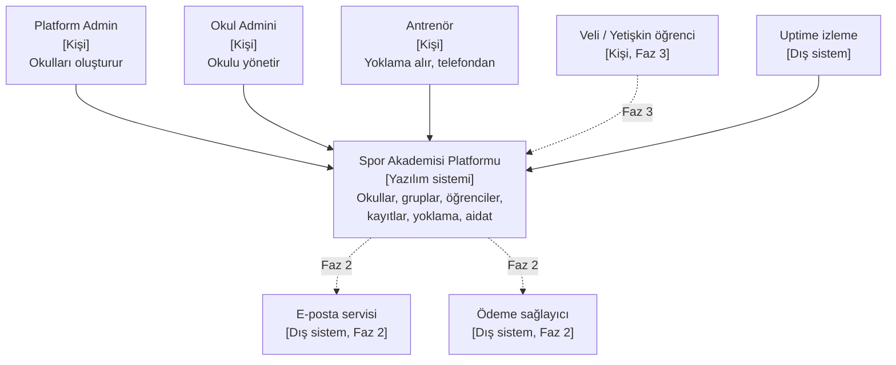
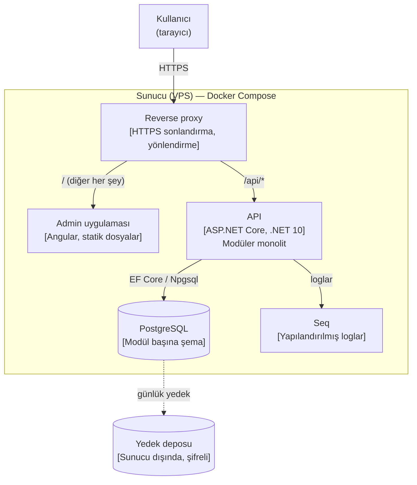
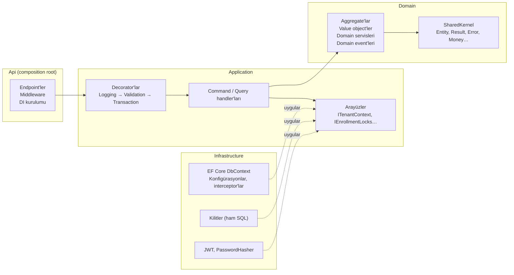
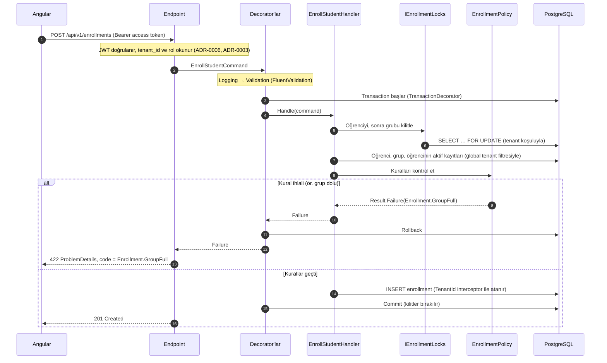
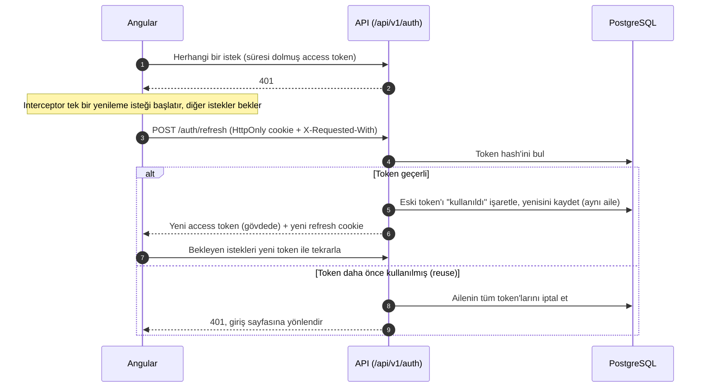

# Mimariye Genel Bakış

> Durum: Onaylandı v1.0 · Repodaki yeri: `docs/architecture/overview.md` · Roadmap maddesi: P0-16

Bu doküman, şimdiye kadar alınan mimari kararları tek bir resimde birleştirir. Kararların gerekçeleri ADR'larda; bu doküman *ne* olduğunu ve parçaların *nasıl* birlikte çalıştığını anlatır. Diyagramlar C4 modelini izler: önce sistemin dış dünyayla ilişkisi (bağlam), sonra çalışan parçalar (container), sonra API'nin içi (component).

## 1. Sistem bağlamı (C4 – Seviye 1)

Sistemi kimler kullanır ve sistem hangi dış sistemlerle konuşur?

## 2. Container'lar (C4 – Seviye 2)

Sistem hangi çalışan parçalardan oluşur? (Burada "container", Docker konteyneri değil; ayrı çalışan bir uygulama veya veri deposu anlamındadır. Bu projede ikisi örtüşüyor.)

| Container | Teknoloji | Sorumluluğu | İlgili kararlar |
| --- | --- | --- | --- |
| Reverse proxy | P0-30'da seçilecek (otomatik HTTPS sağlayan bir proxy) | HTTPS, HSTS, `/api` isteklerini API'ye, diğerlerini admin uygulamasına yönlendirme. Uygulama ve API aynı origin'den sunulur | DEC-054, NFR-SEC-02 |
| Admin uygulaması | Angular | Okul Admini ve Antrenör arayüzü; mobil öncelikli antrenör ekranları. Access token'ı sadece bellekte tutar | DEC-024, DEC-053, NFR-USA-01 |
| API | ASP.NET Core, .NET 10 | Tüm iş mantığı, kimlik doğrulama, yetkilendirme. Durumsuz (stateless) | ADR-0001, ADR-0006, NFR-SCL-01 |
| PostgreSQL | PostgreSQL | Tek veritabanı; her modülün kendi şeması; tüm okullar aynı tablolarda (`TenantId`) | ADR-0003, DEC-038 |
| Seq | Seq | Yerelde ve sunucuda yapılandırılmış logların aranması | NFR-OBS-01 |
| Yedek deposu | Sunucu dışı nesne depolama (P0-30'da seçilecek) | Şifreli günlük yedekler, 30 gün | NFR-REL-03 |

## 3. API'nin içi (C4 – Seviye 3)

### 3.1 Katmanlar ve modüller

API, dört katmandan ve her katmanın içinde dokuz modülden oluşur (ADR-0001). Bağımlılıklar her zaman içe, `Domain`'e doğrudur.

| Modül | Sahip olduğu aggregate'lar | Veritabanı şeması |
| --- | --- | --- |
| `Tenancy` | School | `tenancy` |
| `Identity` | User (RefreshToken dahil) | `identity` |
| `Organization` | Sport, Facility | `organization` |
| `Groups` | Group (program saatleri ve aidat tanımları dahil) | `groups` |
| `Students` | Student, Guardian | `students` |
| `Enrollments` | Enrollment | `enrollments` |
| `Attendance` | Session (yoklama kayıtları dahil) | `attendance` |
| `Billing` | Payment | `billing` |
| `Announcements` | Announcement | `announcements` |

### 3.2 Modüller arası ilişkiler

Bir modül başka bir modülün aggregate'ını doğrudan değiştiremez (DEC-039). Aşağıdaki tablo, hangi modülün hangi bilgiye ihtiyaç duyduğunu ve hangi event'lere tepki verdiğini gösterir.

| Modül | Okuduğu bilgi (başka modülden) | Yayınladığı event'ler | Tepki verdiği event'ler |
| --- | --- | --- | --- |
| `Tenancy` | — | — | — |
| `Identity` | — | `UserDeactivated`, `PasswordChanged` | `PasswordChanged` (kendi içinde) |
| `Organization` | — | — | — |
| `Groups` | Antrenörün diğer grupları, tesis bilgisi (Organization) | `GroupArchived` | `UserDeactivated` (`CoachId`'yi boşaltır) |
| `Students` | — | `StudentLeft` | — |
| `Enrollments` | Öğrenci durumu ve doğum tarihi (Students); grup kontenjanı, doğum yılı aralığı, program saatleri (Groups) | — | `StudentLeft`, `GroupArchived` (kayıtları sonlandırır) |
| `Attendance` | Gruptaki aktif kayıtlar (Enrollments); grubun programı ve antrenörü (Groups) | — | — |
| `Billing` | Kayıtlar (Enrollments); grup aidatları (Groups) | — | — |
| `Announcements` | Grubun antrenörü (Groups) | — | — |

### 3.3 Bir isteğin yolculuğu: öğrenciyi gruba kaydetme (US-17)

Bu diyagram, ADR-0001, ADR-0003, ADR-0004, ADR-0005 ve ADR-0007'deki kararların tek bir istekte nasıl birlikte çalıştığını gösterir.

### 3.4 Oturum yenileme (US-04)

## 4. Ortamlar ve dağıtım

| Ortam | Nerede | Veri | Ne zaman güncellenir |
| --- | --- | --- | --- |
| Yerel | Geliştiricinin bilgisayarı, Docker Compose (PostgreSQL, Seq); API ve Angular IDE'den | Seed verisi | Her an |
| CI | GitHub Actions; testler için Testcontainers ile geçici PostgreSQL | Test verisi | Her PR |
| Staging | VPS, ayrı veritabanı | Sentetik demo verisi (DEC-031) | `main`'e her merge'de otomatik |
| Production | VPS, ayrı veritabanı | Sentetik demo verisi (faz 4'e kadar, DEC-031) | Elle onaydan sonra, hafta içi 09:00–14:00 (NFR-REL-02) |

Staging ve production'ın aynı sunucuda mı, ayrı sunucularda mı çalışacağı P0-30'da, bütçe (DEC-034) göz önünde tutularak belirlenecek.

## 5. Kalite hedefleri nasıl karşılanıyor?

| Hedef | Nasıl karşılanıyor | Kaynak |
| --- | --- | --- |
| Tenant izolasyonu | Global query filter, yazma interceptor'ı, bileşik foreign key'ler, okul bazında benzersiz index'ler, izolasyon test paketi | ADR-0003 |
| Kontenjan tutarlılığı | `FOR UPDATE` kilitleri, sabit kilit sırası, kısmi benzersiz index | ADR-0005 |
| Oturum güvenliği | Bellekte access token, HttpOnly refresh cookie, rotation ve reuse detection | ADR-0006 |
| Veri minimizasyonu | Öğrenciler kullanıcı değil; antrenör sadece acil durum telefonunu görür; contract testleri | ADR-0002, DEC-007 |
| Bakım kolaylığı | Katmanlar ve modüller, mimari testleri, decorator'lar | ADR-0001, ADR-0004 |
| Güvenilir test | Gerçek PostgreSQL ile API entegrasyon testleri | ADR-0008 |
| Tutarlı hata yönetimi | `Result` / `Error`, ProblemDetails, hata kodları | ADR-0007 |
| Düşük maliyet | Tek sunucu, tek veritabanı, tek API imajı | ADR-0001, ADR-0003 |

## 6. ADR dizini

| ADR | Başlık | Durum |
| --- | --- | --- |
| 0001 | Clean Architecture katmanlarıyla modüler monolit | Accepted |
| 0002 | Öğrenciler profildir; veli sadece reşit olmayanlar için zorunlu | Accepted |
| 0003 | Paylaşımlı veritabanı ve `TenantId` ile multi-tenancy | Accepted |
| 0004 | Handler'lar, decorator'lar ve elle mapping | Accepted |
| 0005 | Kayıt sırasında pessimistic locking | Accepted |
| 0006 | Bellekte access token, HttpOnly cookie'de refresh token | Accepted |
| 0007 | Result pattern ve ProblemDetails | Accepted |
| 0008 | Test stratejisi | Accepted |
| 0009 | Modüller arası iletişim ve domain event'lerinin transaction içinde işlenmesi | Accepted |
