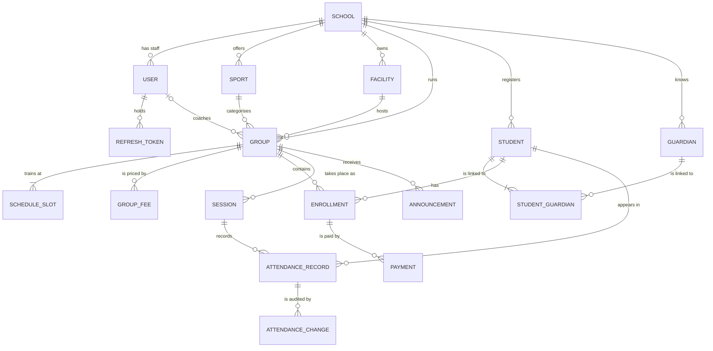

# Domain Modeli — MVP (v0.1.0)

> Durum: Onaylandı v1.2 · Repodaki yeri: `docs/domain/domain-model.md` · Kaynaklar: `vision.md`, `user-stories.md`

## 1. Ortak dil (ubiquitous language)

Bir kelime, her yerde tek bir anlam: konuşmalarda, dokümanlarda, kodda, veritabanında ve arayüzde. Kod İngilizce terimi, arayüz Türkçe karşılığını kullanır.

| Terim (kod) | Türkçe (arayüz) | Anlamı |
| --- | --- | --- |
| School / Tenant | Okul | Platformu kullanan bir spor okulu. "Tenant" teknik, "School" iş dünyası terimidir; ikisi aynı şeydir |
| Sport | Branş | Bir okulun sunduğu spor dalı (Futbol, Yüzme) |
| Facility | Tesis | Antrenmanın yapıldığı fiziksel yer (A Sahası, 1 Numaralı Havuz) |
| Group | Grup | Tek bir branş, doğum yılı aralığı ve antrenöre sahip, haftalık bir programla antrenman yapan öğrenci topluluğu |
| Schedule slot | Program saati | Bir grubun haftalık olarak tekrar eden zaman dilimi (Salı 17:00–18:30) |
| Session | Antrenman | Bir program saatinin belirli bir tarihteki somut gerçekleşmesi (Salı 14 Ocak 2027, 17:00–18:30) |
| Student | Öğrenci | Bir okula kayıtlı kişi; çocuk veya yetişkin olabilir. Bir profildir, kullanıcı değildir |
| Minor / Adult | Reşit olmayan / Yetişkin | Kontrol tarihinde 18 yaşından küçük olan öğrenci reşit değildir; diğerleri yetişkindir |
| Guardian | Veli | Bir veya daha fazla reşit olmayan öğrenciden sorumlu yetişkin |
| Emergency contact | Acil durum kişisi | Acil durumda aranacak kişi; veli olabilir de olmayabilir de. Antrenör sadece telefonunu görür |
| Enrollment | Kayıt | Bir öğrencinin belirli bir dönem boyunca bir gruba üyeliği |
| Attendance | Yoklama | Bir öğrencinin bir antrenmana katılıp katılmadığı |
| Fee | Aidat | Bir grup için alınan aylık tutar |
| Period | Dönem | Aidat açısından bir takvim ayı (2027-01) |
| Payment | Ödeme | Bir kayıt ve dönem için alınan para |
| Due | Borç | Bir kayıt ve dönem için ödenmesi gereken aidat, eksi geçerli ödemeler |

Belirsiz oldukları için kullanılmayacak kelimeler: "class" (programlama terimiyle çakışır), "lesson" (Session kullan), "member" (Student veya User kullan), "registration" (gruplar için Enrollment kullan; "register" sadece öğrenci oluşturmak için).

## 2. Modele genel bakış

## 3. Kullanılan yapı taşları

- **Entity:** Verisi değişse de aynı kalan bir kimliği vardır (soyadını değiştiren bir öğrenci hâlâ aynı öğrencidir).
- **Value object:** Sadece değerleriyle tanımlanır, değişmezdir (immutable), kimliği yoktur (iki `Money(500, TRY)` birbirine eşittir). Doğrulama constructor'ında yapılır; böylece geçersiz bir value object asla var olamaz.
- **Aggregate:** Tek bir giriş noktası (**aggregate root**) üzerinden, tek bir birim olarak birlikte değişen nesneler kümesi. Aggregate, bir transaction'ın ve kurallarının (invariant) sınırıdır. Diğer aggregate'lara asla nesne referansıyla değil, **sadece ID ile** başvurulur.
- **Invariant:** Her zaman doğru olması gereken bir kural. Her invariant'ın tek bir sahibi vardır: içinde kontrol edilebiliyorsa bir aggregate, birden fazla aggregate'ı kapsıyorsa bir domain servisi.
- **Domain event:** Domain'de gerçekleşmiş bir olay (`StudentLeft`); aggregate'ları birbirine bağımlı hale getirmeden yan etkileri tetiklemek için kullanılır.

## 4. Aggregate'lar

Tenant'a bağlı her aggregate `ITenantScoped` arayüzünü uygular (`TenantId` alanı vardır). Tüm ID'ler UUID v7'dir.

### 4.1 School (aggregate root) — tenant'a bağlı değil

| Alan | Tip | Notlar |
| --- | --- | --- |
| Id | `SchoolId` | Diğer her yerde `TenantId` olarak da kullanılır |
| Name | string | |
| Slug | `Slug` (VO) | Küçük harf, `a-z0-9-`, platform genelinde benzersiz |
| TimeZone | string (IANA) | ör. `Europe/Istanbul` |
| Status | `Active` / `Deactivated` | |
| RetentionPolicy | `RetentionPolicy` (VO) | Kişisel verilerin anonimleştirilmesinden önceki ay sayısı; ödemelerin saklanacağı yıl sayısı |

### 4.2 User (aggregate root)

| Alan | Tip | Notlar |
| --- | --- | --- |
| Id | `UserId` | |
| TenantId | `SchoolId?` | Sadece Platform Admin için `null` |
| Email | `Email` (VO) | Küçük harfe normalize edilir, platform genelinde benzersiz |
| PasswordHash | string | Asla şifrenin kendisi değil |
| Role | `PlatformAdmin` / `SchoolAdmin` / `Coach` | |
| FirstName, LastName, Phone | | Phone, `PhoneNumber` (VO) tipindedir |
| Status | `Active` / `Deactivated` | |
| MustChangePassword | bool | Oluşturulduktan veya admin sıfırlamasından sonra true |
| FailedLoginCount, LockoutEndsAt | | Hesap kilitleme için (US-03) |

**RefreshToken** (entity, ayrı tablo, User'a ait): `TokenHash`, `FamilyId`, `ExpiresAt`, `RevokedAt`, `ReplacedByTokenId`. Bir refresh token'ın, şifre gibi sadece **hash'i** saklanır. `FamilyId`, birbirinin yerine geçen (rotate edilen) token zincirini gruplar; böylece eski bir token tekrar kullanılırsa tüm aile iptal edilir (US-04).

**Invariant'lar:** Platform Admin'in TenantId'si yoktur; diğer her rolün vardır. Pasif bir kullanıcının geçerli refresh token'ı yoktur.

Antrenör, `Coach` rolüne sahip bir User'dır; MVP'de ayrı bir Coach varlığı yoktur.

### 4.3 Sport (aggregate root)

`Id`, `TenantId`, `Name`, `IsArchived`. **Invariant:** isim okul bazında benzersizdir (büyük-küçük harf duyarsız).

### 4.4 Facility (aggregate root)

`Id`, `TenantId`, `Name`, `Type` (`Field` / `Pool` / `Court` / `Other`), `Address` (VO), `Capacity?`, `IsArchived`.

### 4.5 Group (aggregate root)

| Alan | Tip | Notlar |
| --- | --- | --- |
| Id, TenantId | | |
| SportId, FacilityId | ID'ler | Diğer aggregate'lara referans |
| CoachId | `UserId?` | Antrenör pasif hale getirildiyse null |
| Name | string | |
| BirthYearRange | `BirthYearRange` (VO) | `From <= To` |
| Capacity | int | `>= 1` |
| Status | `Active` / `Archived` | |
| ScheduleSlots | `ScheduleSlot` (VO) listesi | `DayOfWeek` + `TimeRange` |
| Fees | `GroupFee` listesi | `EffectiveFrom` (`YearMonth`) + `Amount` (`Money`) |

**Aggregate içindeki invariant'lar:**
- Aynı grubun program saatleri asla çakışmaz.
- `TimeRange.End > TimeRange.Start`.
- Her `EffectiveFrom` dönemi için tek bir aidat vardır; geçmiş dönemler değiştirilemez.

**Dışarıdan veri gerektiren kurallar (bir domain servisi tarafından kontrol edilir, bkz. bölüm 5):** antrenörün müsaitliği, tesis çakışması uyarısı, aktif kayıtlara göre kontenjan.

### 4.6 Student (aggregate root)

| Alan | Tip | Notlar |
| --- | --- | --- |
| Id, TenantId | | |
| FirstName, LastName | | Ayrıca normalize edilmiş bir arama sütunu (bkz. US-16) |
| BirthDate | `DateOnly` | |
| Gender | `Female` / `Male` | |
| Status | `Active` / `Left` | |
| LeftAt | `DateOnly?` | |
| AnonymizedAt | `DateTimeOffset?` | Faz 2'de doldurulur |
| Phone | `PhoneNumber?` (VO) | Öğrencinin kendi telefonu; yetişkinler için zorunlu |
| Email | `Email?` (VO) | Öğrencinin kendi e-postası; isteğe bağlı |
| EmergencyContact | `EmergencyContact` (VO) | Ad, telefon, yakınlık; her öğrenci için zorunlu |
| Guardians | `StudentGuardian` listesi | `GuardianId`, `Relationship` |

**Invariant'lar:**
- Her öğrencinin tam olarak bir acil durum kişisi vardır.
- Reşit olmayan bir öğrencinin en az bir velisi vardır.
- Yetişkin bir öğrencinin kendi telefonu vardır; velisi olması gerekmez.
- `LeftAt` sadece ve sadece `Status = Left` ise doludur.

Reşit olma durumu, kontrolün yapıldığı tarihte okulun saat dilimine göre hesaplanır ("bugün" `TimeProvider`'dan alınır). Kurallar öğrenci oluşturulurken veya velileri ve iletişim bilgileri değiştirilirken kontrol edilir; bir öğrencinin 18 yaşına basması mevcut kaydı geçersiz kılmaz. (Bkz. ADR-0002.)

`Relationship` (`Mother` / `Father` / `Other`), Guardian üzerinde değil bağlantı üzerinde durur, çünkü belirli bir öğrenciyle olan ilişkiyi anlatır.

Acil durum kişisi bir veli olabilir, ama bilgileri öğrenci üzerinde ayrı tutulur. Bu sayede antrenör görünümü veli tablosuna hiç erişmez (DEC-007).

### 4.7 Guardian (aggregate root)

`Id`, `TenantId`, `FirstName`, `LastName`, `Phone` (VO), `Email?`, `Address?`. **Invariant:** telefon okul bazında benzersizdir (kardeşlerin aynı veliyi paylaşması bu sayede olur, US-13).

### 4.8 Enrollment (aggregate root)

`Id`, `TenantId`, `StudentId`, `GroupId`, `StartDate`, `EndDate?`, `Status` (`Active` / `Ended`).

**İç invariant:** `EndDate >= StartDate`; `Ended` sadece ve sadece `EndDate` doluysa.

**Aggregate'lar arası invariant'lar (kayıt politikası, bkz. bölüm 5):** öğrenci Active; doğum yılı grubun aralığında; grupta boş yer var; aynı grupta aktif kaydı yok; diğer aktif kayıtlarıyla çakışan program saati yok.

Enrollment, Group'un bir parçası değil, ayrı bir aggregate'tır. Group'un içinde olsaydı, bir grubu yüklemek yılların kayıt geçmişini de yüklemek anlamına gelirdi ve her yoklama veya ödeme işlemi tüm grubu kilitlerdi. Bu seçimin bedeli, kontenjanın aggregate'lar arası bir kural haline gelmesi ve bir eşzamanlılık stratejisi gerektirmesidir (ADR-0005, adım 5).

### 4.9 Session (aggregate root)

| Alan | Tip | Notlar |
| --- | --- | --- |
| Id, TenantId, GroupId | | |
| Date | `DateOnly` | |
| TimeRange | `TimeRange` (VO) | Program saatinden kopyalanan **anlık görüntü (snapshot)** |
| Records | `AttendanceRecord` listesi | |

Bir antrenman, onun için ilk kez yoklama kaydedildiğinde **tembel (lazy) olarak oluşturulur**. Planlanan antrenmanlar programdan hesaplanır, saklanmaz. Saat aralığı kopyalanır; böylece grubun programı sonradan değişse bile geçmiş asla yeniden yazılmaz. Benzersiz anahtar: `(GroupId, Date, StartTime)`.

**AttendanceRecord** (entity): `StudentId`, `Status` (`Present` / `Absent` / `Late` / `Excused`), `RecordedBy`, `RecordedAt`.
**AttendanceChange** (entity): `PreviousStatus`, `NewStatus`, `ChangedBy`, `ChangedAt`.

**Invariant'lar:** gelecekteki bir antrenman için yoklama kaydedilemez; bir antrenmanda her öğrenci için tek kayıt; Antrenör kayıtları sadece antrenman bittikten sonraki 48 saat içinde değiştirebilir. Şimdiki zaman `DateTime.Now`'dan değil, .NET'in `TimeProvider`'ından alınır; böylece 48 saat kuralı test edilebilir.

### 4.10 Payment (aggregate root)

| Alan | Tip | Notlar |
| --- | --- | --- |
| Id, TenantId | | |
| EnrollmentId, StudentId | ID'ler | StudentId, raporlama için tekrar (denormalize) tutulur |
| Period | `YearMonth` (VO) | |
| Amount | `Money` (VO) | `decimal(12,2)` + para birimi, `> 0` |
| Method | `Cash` / `BankTransfer` | |
| PaidOn | `DateOnly` | |
| Status | `Recorded` / `Cancelled` | |
| CancelReason, CancelledBy, CancelledAt | | İptal edildiğinde zorunlu |

**Invariant'lar:** asla düzenlenmez, asla silinmez; iptal için gerekçe zorunludur. **Borç hesaplanır, saklanmaz:** kaydın en az bir gün aktif olduğu her dönem için `borç = o dönemin grup aidatı − Recorded durumundaki ödemelerin toplamı`.

### 4.11 Announcement (aggregate root, Could)

`Id`, `TenantId`, `GroupId`, `Title`, `Body`, `CreatedBy`, `CreatedAt`.

## 5. Domain servisleri

| Servis | Sorumluluğu |
| --- | --- |
| `EnrollmentPolicy` | Aggregate'lar arası tüm kayıt kurallarını kontrol eder (US-17) |
| `ScheduleConflictChecker` | Antrenör müsaitliği ve tesis çakışması (US-10) |
| `SessionCalendar` | Bir grubun bir tarih aralığındaki planlanan antrenmanlarını program saatlerinden hesaplar |
| `DueCalculator` | Kayıt ve dönem bazında borçları hesaplar (US-24) |

Domain servisleri sadece iş kurallarını içerir. İhtiyaç duydukları veriyi (veya onu getirecek salt okunur arayüzleri) parametre olarak alırlar; veritabanını veya dış sistemleri asla doğrudan çağırmazlar.

## 6. Domain event'leri (MVP)

Aynı transaction içinde, commit'ten önce işlenir; herhangi bir adım başarısız olursa asıl değişiklik de geri alınır. Event işleyicileri sadece veritabanı içi değişiklik yapar; dış sistemlere giden yan etkiler (e-posta vb.) faz 2'de outbox ile commit'ten sonra çalışır. Başka bir modüldeki değişiklik event işleyicisi tarafından, o modülün `Contracts` sözleşmesi üzerinden yapılır. (Bkz. ADR-0009.)

| Event | Yayınlayan | Etkisi |
| --- | --- | --- |
| `StudentLeft` | Student | Öğrencinin aktif kayıtlarını `LeftAt` tarihinde sonlandırır |
| `GroupArchived` | Group | Grubun aktif kayıtlarını bugünün tarihiyle sonlandırır |
| `UserDeactivated` | User | Tüm refresh token'ları iptal eder; antrenörse gruplarındaki `CoachId`'yi boşaltır |
| `PasswordChanged` | User | Diğer tüm refresh token'ları iptal eder |

## 7. Value object'ler

| Value object | Kurallar |
| --- | --- |
| `Email` | Geçerli format, baştaki/sondaki boşluklar temizlenmiş, küçük harf |
| `PhoneNumber` | E.164 formatına normalize edilir (`+905321234567`); böylece aynı numara her zaman aynı şekilde saklanır |
| `Money` | `decimal` tutar + ISO para birimi; aritmetik işlemler sadece aynı para birimiyle |
| `BirthYearRange` | `From <= To`, makul yıllar |
| `TimeRange` | `End > Start`, çakışma kontrolü |
| `ScheduleSlot` | `DayOfWeek` + `TimeRange` |
| `YearMonth` | Yıl ve ay, karşılaştırılabilir |
| `Address` | Adres satırı, ilçe, il |
| `EmergencyContact` | Ad (zorunlu), `PhoneNumber` (zorunlu), yakınlık (zorunlu, serbest metin, en fazla 50 karakter) |
| `Slug` | `^[a-z0-9]+(-[a-z0-9]+)*$` |
| `RetentionPolicy` | Pozitif süreler |

## 8. Genel kurallar

- **ID'ler:** UUID v7 (`Guid.CreateVersion7()`). Zamana göre sıralı oldukları için, rastgele v4 GUID'lerin aksine veritabanı index'leri kompakt kalır; ayrıca ID'ler kaydetmeden önce kodda üretilebilir.
- **Denetim (auditing):** her tabloda `CreatedAt`, `CreatedBy`, `UpdatedAt`, `UpdatedBy` bulunur ve bir EF Core interceptor'ı tarafından otomatik doldurulur.
- **Genel soft delete yok:** teknik bir `IsDeleted` alanı yerine varlıkların iş anlamı taşıyan durumları vardır (`Archived`, `Left`, `Ended`, `Cancelled`). Her biri bir şeyin *neden* pasif olduğunu söyler.
- **Zaman:** anlar UTC `timestamptz` olarak saklanır; tarihler ve yerel saatler (`DateOnly`, `TimeOnly`) okulun saat dilimine göre yorumlanır.
- **Eşzamanlılık:** her aggregate root'un optimistic concurrency için bir eşzamanlılık token'ı (PostgreSQL `xmin`) vardır.

## 9. Onaylanan kararlar

| # | Karar |
| --- | --- |
| D1 | Antrenör, `Coach` rolüne sahip bir User'dır; ayrı bir Coach varlığı yoktur |
| D2 | Antrenmanlar ilk yoklamada tembel olarak oluşturulur ve saat aralığının anlık görüntüsünü tutar |
| D3 | Kaydın en az bir gün aktif olduğu her ay için tam aylık aidat alınır; MVP'de kıst (orantılı) hesaplama yok |
| D4 | Enrollment ayrı bir aggregate'tır; kontenjan eşzamanlılık stratejisi ADR-0005'te belirlenir |
| D5 | Genel soft delete yok; bunun yerine iş anlamı taşıyan durumlar |
| D6 | Cinsiyet değerleri: `Female` / `Male`; bazı branşlarda gruplama için gerekli |
| D7 | Yetişkin öğrenciler desteklenir: veli sadece reşit olmayanlar için zorunlu; yetişkinler için kendi telefonu zorunlu |
| D8 | Acil durum kişisi, velilerden bağımsız olarak öğrenciye ait bir value object'tir |
